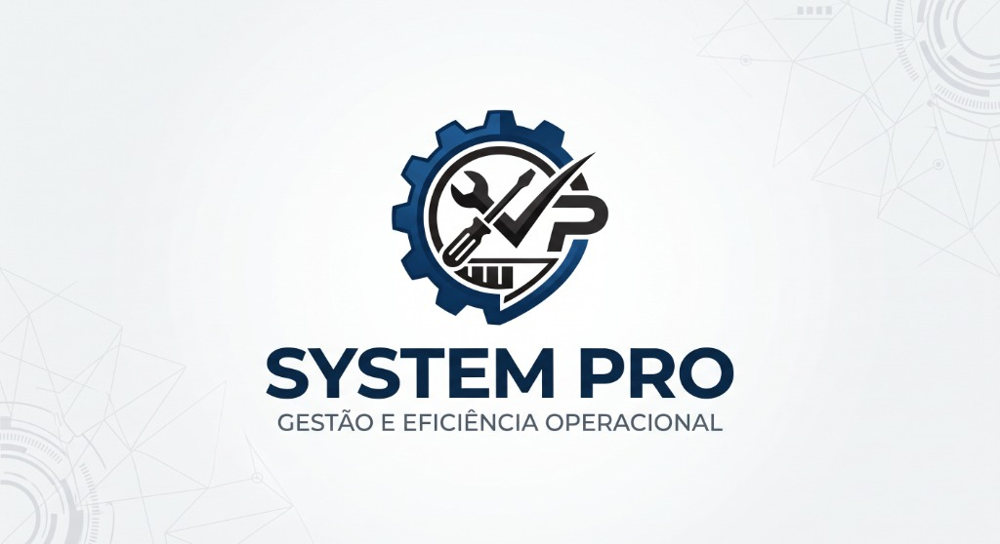

<div align="center">



# SYSTEM PRO
### Plataforma Corporativa de Gestão para Assistência Técnica e Varejo

[]([https://github.com/DanielWallans](https://github.com/DanielWallans/ITTHECNICA-))
[]()
[](https://github.com/DanielWallans/System-Pro)
[](https://openjdk.org/)
[](https://www.mysql.com/)

<p align="center">
  <b>Solução de alto desempenho desenvolvida para controle rigoroso de ordens de serviço, frente de caixa com múltiplos pagamentos, demonstrativo financeiro em tempo real e monitoramento de terminais em rede local.</b>
</p>

---

</div>

## Sobre o Projeto e Desenvolvimento

O **SYSTEM PRO** foi projetado e construído de forma independente e profissional pela **IT THECNICA**, sob liderança e visão estratégica de **DANIEL WALLANS (CEO)**.

A plataforma foi concebida para atender às exigências de oficinas de reparo, centros de assistência técnica (computadores, notebooks, celulares, tablets, consoles e eletrônicos) e lojas de peças e acessórios. O sistema integra todos os processos da empresa em tempo real: da entrada do equipamento na bancada técnica ao fechamento do caixa, cálculo de DRE contábil e auditoria remota de operadores.

---

## Arquitetura de Software e Padrões de Engenharia

O **SYSTEM PRO** adota uma arquitetura em camadas baseada nos princípios de **Clean Architecture**, **SOLID** e nos padrões clássicos de projeto do **Gang of Four (GoF)**. O isolamento rigoroso entre a camada de apresentação gráfica (Swing/FlatLaf), os serviços de negócio e os mecanismos de persistência garante alta testabilidade, baixo acoplamento e escalabilidade.

```
com.loja
├── app
│   └── Main.java                         # Bootstrap, configuração de look-and-feel e orquestração inicial
├── context
│   └── AppContext.java                   # Container de Inversão de Controle (IoC) & Service Locator
├── event
│   ├── AppEvent.java                     # Contrato base de eventos de domínio
│   ├── AppEventListener.java             # Interface funcional para listeners reativos
│   ├── EventBus.java                     # Barramento thread-safe para sincronização assíncrona
│   └── events
│       ├── OSAlteradaEvent.java          # Evento de ciclo de vida de Ordem de Serviço
│       ├── EstoqueAlteradoEvent.java     # Evento de movimentação física de peças/produtos
│       ├── VendaRealizadaEvent.java      # Evento de fechamento de venda no PDV
│       └── CaixaAlteradoEvent.java       # Evento de movimentações financeiras no caixa
├── exception
│   ├── AppException.java                 # Exceção raiz da aplicação
│   ├── BusinessRuleException.java        # Violações de regras operacionais do negócio
│   ├── ValidationException.java          # Inconsistências cadastrais e de entrada de dados
│   └── EntityNotFoundException.java      # Entidades ausentes na base de dados
├── model
│   └── (Entidades de Domínio)            # Cliente, Equipamento, OrdemServico, Produto, VendaPDV, etc.
├── repository
│   ├── contract                          # Repository Pattern (Abstrações / Princípio da Inversão de Dependência)
│   │   ├── ClienteRepository.java
│   │   ├── EquipamentoRepository.java
│   │   ├── ProdutoRepository.java
│   │   ├── OrdemServicoRepository.java
│   │   ├── CaixaRepository.java
│   │   ├── FinanceiroRepository.java
│   │   ├── UsuarioRepository.java
│   │   └── EstoqueMovimentoRepository.java
│   └── (DAOs Concretos)                  # Implementações JDBC com transações gerenciadas
├── service
│   ├── ClienteService.java               # Regras cadastrais, validações e integridade de exclusão
│   ├── EquipamentoService.java           # Relações de posse de equipamentos e históricos de manutenção
│   ├── ProdutoService.java               # Regras de precificação, margem, alertas e estoque crítico
│   ├── OrdemServicoService.java          # Máquina de estados da OS, orçamentos e auditoria
│   ├── CaixaService.java                 # Turnos, conferência cega, sangrias e suprimentos
│   ├── FinanceiroService.java            # Contas a pagar, folha de colaboradores e apuração de DRE
│   ├── UsuarioService.java               # Autenticação, controle de perfis RBAC e criptografia
│   ├── AutoBackupService.java            # Agendamento periódico e backups automáticos
│   └── update/UpdateService.java         # Atualização automatizada por rede local ou nuvem
├── util
│   ├── AppLogger.java                    # Logging estruturado com timestamps, threads e níveis
│   ├── ValidationUtils.java              # Validação algorítmica de CPF/CNPJ (Módulo 11)
│   └── LogoUtil.java                     # Gerenciamento de ativos visuais em múltiplos formatos
└── view
    ├── components                        # Painéis especializados (ex: galeria fotográfica de laudos)
    ├── dialogs                           # Diálogos modais de entrada de dados e conferência
    ├── theme                             # Design Tokens, tipografia e temas FlatLaf (Dark Graphite)
    └── (Panels Principais)               # Telas do sistema vinculadas via EventBus reativo
```

### Principais Padrões Arquiteturais Implementados

#### 1. Inversão de Controle e Service Locator (IoC Container)
O componente `AppContext` atua como o container de injeção de dependências do sistema. Em vez de instanciar diretamente objetos concretos com acoplamento rígido, os componentes obtêm suas instâncias tipadas a partir do container central, facilitando a substituição de implementações e a criação de ambientes controlados de teste.

#### 2. Repository Pattern e Inversão de Dependência (SOLID - DIP)
Todas as operações de acesso a dados são mediadas por interfaces no pacote `com.loja.repository.contract`. A camada de negócio desconhece as instruções SQL específicas, dependendo unicamente de contratos abstratos. Isso permite migrar ou estender o mecanismo de persistência sem impacto nas regras de negócio.

#### 3. Domain Service Layer
As regras corporativas e validações residem exclusivamente na camada `service`, nunca nos painéis visuais ou nos DAOs:
* Validações de integridade referencial antes de exclusões;
* Rastreamento auditável de alterações de status;
* Controle de concorrência e consistência de valores monetários.

#### 4. Barramento Reativo de Eventos (Observer Pattern / EventBus)
A interface do usuário é atualizada em tempo real por meio de eventos publicados no `EventBus`. Quando uma venda é concluída no PDV, os eventos `VendaRealizadaEvent` e `CaixaAlteradoEvent` são emitidos. Os painéis interessados (`DashboardPanel`, `EstoquePanel` e `CaixaPanel`) capturam a notificação e atualizam suas métricas e tabelas de forma assíncrona, eliminando chamadas cruzadas diretas entre janelas.

#### 5. Tratamento Estruturado de Exceções
Uma taxonomia clara de exceções foi estabelecida em `com.loja.exception`. Erros de validação do operador geram `ValidationException` com a listagem exata dos campos pendentes; violações operacionais geram `BusinessRuleException` exibindo mensagens claras na interface; falhas de conectividade são capturadas e logadas sem interromper a execução global.

#### 6. Logging Estruturado Corporativo
Substituição de saídas de texto não padronizadas pelo `AppLogger`, provendo saída cronológica com marcação de data/hora, identificador da thread executora, classe emissora e níveis de severidade (INFO, WARN, ERROR, DEBUG).

#### 7. Validação Algorítmica Oficial
O utilitário `ValidationUtils` processa as validações de documentos fiscais conforme as regras oficiais da Receita Federal (cálculo de dois dígitos verificadores em Módulo 11 para CPF e CNPJ), impedindo a persistência de registros corrompidos na base de dados.

---

## Visão Geral dos Recursos

```
┌────────────────────────────────────────────────────────────────────────┐
│                               SYSTEM PRO                               │
├───────────────────┬───────────────────┬────────────────────────────────┤
│ Atendimento & OS  │ Vendas & Balcão   │ Gestão & Controladoria         │
│ • Ordens de Serv. │ • PDV Rápido      │ • DRE em Tempo Real            │
│ • Laudo Fotográfico│ • Múltiplos Pagto │ • Controle de Estoque          │
│ • Comprovantes PDF│ • Cupom Térmico   │ • Contas a Pagar & Despesas    │
│ • WhatsApp 1-Click│ • Baixa em Estoque│ • Folha & Comissões            │
├───────────────────┴───────────────────┴────────────────────────────────┤
│ Conectividade & Infraestrutura                                         │
│ • Central de Terminais em Rede Local (Multi-estações)                  │
│ • Monitoramento de Operadores em Tempo Real                            │
│ • Mensagens Broadcast Instantâneas para Todos os Caixas                │
│ • Bloqueio & Desbloqueio Remoto de Segurança                          │
│ • Atualização Automática via Banco de Dados (Auto-Update)              │
│ • Rotinas de Backup Automatizado em Segundo Plano                      │
└────────────────────────────────────────────────────────────────────────┘
```

---

## Detalhamento das Funcionalidades

### 1. Gestão de Ordens de Serviço (OS)
O núcleo operacional da assistência técnica com controle ponta a ponta:
* **Fluxo de Estados Operacionais:** Abertura, Análise Técnica, Aguardando Peças, Aguardando Aprovação, Aprovado, Em Manutenção, Pronto para Retirada, Concluído/Entregue e Cancelado.
* **Orçamento Integrado:** Composição detalhada de peças retiradas do estoque e serviços de mão de obra técnica, com recálculo automático de subtotais, descontos e valor final.
* **Galeria Fotográfica da OS (Vistoria de Entrada e Saída):** Registro fotográfico anexado à ordem de serviço demonstrando o estado visual de entrada do equipamento (riscos, trincas na carcaça, display quebrado) e o resultado após a manutenção. Fornece respaldo jurídico para a empresa e transparência absoluta para o cliente.
* **Emissão de Comprovantes em PDF:** Impressão de Termo de Entrada de Equipamento com cláusulas de responsabilidade e Comprovante de Entrega com termo de garantia contratual e campo de assinatura física.
* **Integração WhatsApp em 1 Clique:** Envio imediato do laudo técnico, valores e aviso de equipamento pronto diretamente para o WhatsApp do cliente.

### 2. Clientes e Histórico de Equipamentos
* **Cadastro Unificado:** Dados cadastrais com validação rigorosa de CPF/CNPJ, telefones com DDD, endereço completo e anotações técnicas.
* **Ficha Técnica por Aparelho:** Relação de equipamentos (Notebook, Desktop, Smartphone, Tablet, Console) vinculados ao cadastro do cliente por número de série, marca e modelo.
* **Histórico Vitalício:** Consulta em tempo real de todas as manutenções prévias, peças aplicadas e garantias ativas para determinado aparelho ou cliente.

### 3. Frente de Caixa e PDV Balcão (Atalho F4)
Foco em agilidade e precisão para atendimento no balcão:
* **Leitura Rápida:** Reconhecimento por código de barras ou busca preditiva por descrição do item.
* **Múltiplas Formas de Pagamento:** Divisão da mesma venda entre Dinheiro (com cálculo imediato de troco), PIX com conferência e Cartões de Débito e Crédito.
* **Dedução Automática de Taxas de Cartão:** Apuração do valor líquido recebido no ato da venda com base nas taxas configuradas para as operadoras de maquininha.
* **Cupom Não Fiscal Térmico:** Impressão direta para impressoras térmicas de bobina contínua (80mm e 58mm) com logotipo, dados da loja e detalhamento de itens.

### 4. Controle de Caixa e Fechamento Cego
Integridade e auditoria rigorosa de numerário:
* **Abertura de Turno:** Registro do operador autenticado e do saldo de troco alocado na gaveta.
* **Sangrias e Suprimentos:** Registro auditado de retiradas de dinheiro com justificativa obrigatória e reforços de caixa.
* **Conferência Cega de Fechamento:** O operador declara os valores físicos contados na gaveta (dinheiro em espécie, comprovantes de cartão e PIX) sem que o sistema exiba o valor esperado pelo banco de dados. Isso previne contagens manipuladas.
* **Auditoria de Divergências:** Relatório automático para a gerência apontando conciliação exata ou divergências de sobras/faltas por turno e operador.

### 5. Controle Inteligente de Estoque
* **Gestão Físico-Financeira:** Controle contínuo de saldo de peças, custo médio unitário, preço de venda e margem de contribuição.
* **Ponto de Reposição:** Alertas visuais imediatos para produtos com estoque zerado ou abaixo do nível mínimo de segurança.
* **Rastreabilidade Total:** Histórico de auditoria registrando cada entrada por reposição, baixa manual por perda, consumo em OS ou saída no balcão com data, hora e responsável.

### 6. Gestão Financeira e DRE Empresarial
Visão contábil e apuração de resultado do negócio:
* **DRE Operacional Automatizado:**
  - **Faturamento Bruto:** Receita consolidada de vendas no balcão, serviços de mão de obra e peças aplicadas em OS.
  - **Custo das Mercadorias Vendidas (CMV):** Custo de aquisição dos itens consumidos.
  - **Margem de Contribuição / Lucro Bruto:** Saldo disponível após cobertura dos custos diretos.
  - **Despesas Operacionais:** Apuração de contas a pagar liquidadas no período e folha de colaboradores.
  - **Resultado Operacional Líquido:** Lucro real apurado da empresa.
* **Contas a Pagar:** Gestão de obrigações fixas e variáveis (aluguel, fornecedores, internet, concessionárias de serviços) com controle de vencimentos e quitações.
* **Folha e Comissões:** Registro de despesas com colaboradores, adiantamentos, vales e bonificações técnicas.
* **Relatórios Executivos em PDF:** Exportação consolidada de relatórios financeiros para auditoria e prestação de contas.

### 7. Central de Terminais e Monitoramento de Rede Local
Projetado para operação em lojas com múltiplas estações de trabalho conectadas via rede local:
* **Descoberta do Servidor Matriz:** Terminais clientes localizam a máquina servidora na rede interna de forma transparente.
* **Monitoramento Centralizado:** Painel gerencial exibindo todas as estações ativas na loja em tempo real:
  - Nome do terminal e IP na rede;
  - Operador conectado no momento;
  - Tela/módulo onde o usuário está trabalhando;
  - Status de conectividade.
* **Transmissão Broadcast de Mensagens:** Disparo de avisos imediatos da gerência que são exibidos na tela de todos os computadores da loja de maneira sincronizada.
* **Comandos Remotos de Segurança:** Capacidade de bloquear ou deslogar terminais da rede local diretamente pela estação matriz.

### 8. Atualização Automática (Auto-Update)
* **Distribuição Unificada:** Quando uma nova versão da plataforma é disponibilizada, os computadores da loja recebem a notificação de atualização automaticamente.
* **Instalação em 1 Clique:** O terminal cliente realiza a substituição do pacote e reinicializa a aplicação sem necessidade de intervenção técnica presencial em cada máquina.

### 9. Segurança, Perfis de Acesso e Backup
* **Controle de Acesso Baseado em Perfis (RBAC):**
  - **Administrador:** Acesso irrestrito a configurações fiscais, relatórios contábeis, gestão de usuários e auditoria de caixas.
  - **Técnico:** Foco operacional na bancada (Ordens de Serviço, vistorias fotográficas, equipamentos e consulta de estoque).
  - **Atendente/Operador:** Frente de caixa (PDV), abertura de chamados e cadastro de clientes, com bloqueio automático a módulos financeiros confidenciais.
* **Rotinas de Backup Automático:** Processamento em segundo plano sem travamento da interface, gravando snapshots consistentes da base de dados em intervalos regulares.

---

## Design e Ergonomia de Interface

* **Tema FlatLaf Dark Graphite:** Ergonomia visual concebida para operadores que passam o dia diante do monitor, minimizando o cansaço ocular.
* **Navegação Produtiva por Teclas de Atalho:**
  - `F2` — Abertura imediata de Ordem de Serviço
  - `F3` — Consulta ágil de Clientes
  - `F4` — Frente de Caixa / PDV
  - `F5` — Atualização instantânea de tabelas e métricas
* **Componentes Padronizados:** Badges com códigos de cor semânticos para status de OS e caixas, tabelas com linhas alternadas e barras de rolagem finas e modernas.

---

## Engenharia e Liderança

<div align="center">

### Desenvolvido e Mantido por:
# **IT THECNICA**

### **Daniel Wallans**
*CEO & Head of Software Engineering*

---

> *"Tecnologia não é apenas sobre linhas de código, mas sobre criar soluções sólidas que impulsionam negócios, reduzem perdas e elevam a eficiência do trabalho humano."*  
> — **Daniel Wallans, CEO da IT THECNICA**

---

<p align="center">
  <b>SYSTEM PRO — Todos os direitos reservados à IT THECNICA.</b><br>
  <i>Plataforma desenvolvida para gestão de alto nível e eficiência operacional.</i>
</p>

</div>
